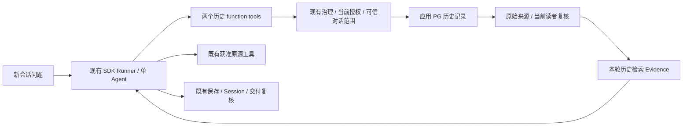

# 跨会话运维事实追溯与事件关联：最小设计及实施计划

> 版本：2026-10-26 / R4（用户确认及 F1/F2 修订）。调查基线：`9d97d5fa24232e5db4fe81d87df7bafb5e6ac1c7`，应用 schema v15，OpenAI Agents SDK 0.22.3。本文维护实施与验收；D1–D3 已确认，生效产品契约只在 ARCHITECTURE 维护。当前仅授权 H1 功能开发与离线验证，H2/H3 尚未获实施授权。
>
> 本轮授权：先修正文档并选择性提交，再从最新 main 在独立主题工作树开发 H1，以真实 SDK、隔离 PostgreSQL、可控模型离线验证。H2 暂不开发，待 H1 审查后再定；不调整权限配置、不合并、不部署、不访问公司源或真实模型，不实施 H3。已有根文档按 [AGENTS.md](../../../AGENTS.md) 分工，生效产品契约以 [ARCHITECTURE.md](../../../ARCHITECTURE.md#operations-history) 为准。

## 1. 结论与范围

小维不是完全没有保存历史，而是**已有事实分散保存、没有面向 Agent 的跨会话发现与读取能力，后台调查结果还存在保存缺口**。先实现获准记录的发现、读取和来源复核，再用原有工具补证。根因比较由同一个 SDK Agent 完成，任务质量另用独立原始材料检验。

推荐新增两个本地受治理只读工具、一处定时结果快照，以及它们与现有 Evidence 验证的窄连接。继续使用现有 PostgreSQL、Runner、Session、工具治理、Action 和交付路径。不需要以向量数据库、知识图谱、第二套调度或 Agent Loop 为前置依赖。

本能力覆盖有获准记录的自动巡检、告警调查、人工调查、操作及验证，不限定 SQL 或单系统。它不承诺从未记录的事实、过期原文或模型常识中恢复真实历史；历史记录也不证明系统现在仍异常或已经恢复。

LLM Wiki 保留调研结论，暂不列实施或试验切片；先交付事实能力，确有经验复用瓶颈时再评估。本期不开发通用记忆平台、自动经验发布、任意新源接入或长期历史归档。这是交付范围，不增加相应运行时禁令。

## 2. 已证实的现状与缺口

### 2.1 锁版能力与实际路径

SDK 0.22.3 的公开 `Session` 提供 `get_items / add_items / pop_item / clear_session`；`SQLAlchemySession` 实现对话存取，没有运维事件检索接口。当前 `Application._turn → Runner.run → function tools → GovernedTools.invoke → Adapter → EvidenceStore.record → Runner → validate_answer → PolicySession.commit_validated` 是实际链路。SDK 原生暂停/恢复用于审批，不需要另建循环。

依据：[锁文件](../../../uv.lock)、[app.py](../../../src/xiaowei/app.py)、[session.py](../../../src/xiaowei/session.py)、[governance.py](../../../src/xiaowei/governance.py)，以及对锁定安装包公开接口的检查；[SDK Session 官方说明](https://openai.github.io/openai-agents-python/sessions/)用于解释公开能力，仓库锁版及执行结果用于判断本产品行为。

| 材料 | 实际保存 / 当前可读路径 | 能复用什么；不能据此认定什么 |
| --- | --- | --- |
| SDK Session / `xiaowei_session` | 过滤后的用户与模型消息、工具调用及 Evidence 引用；按绑定会话回放 | 连续对话。`PolicySession` 会移除 reasoning，工具输出保存引用，无证据失败不保留完整细节；不能作为完整故障日志或跨会话检索 API |
| `xiaowei_evidence` | 来源、目标、采集/记录时间、调用绑定、策略指纹、对象依赖、各用途获准投影及期限 | 已保存的最小事实。原始响应不保存，字段会省略，超大顶层字段可能整体不保留；DB 的 `truncated` 与投影内截断提示都要读 |
| `xiaowei_request` | 交互请求及完整 `TurnAnswer` JSON，包括全部模型可见 Evidence、失败元数据和预算收尾状态；会话快照单独保存 | 人工调查结果与不完整性。现有 `ChannelStore.get` 按已知请求、原发起人及入口读取，没有历史搜索 |
| `xiaowei_scheduled_run` | run/job、计划时间、Session/turn、状态/原因、排队/开始/结束时间，共 10 列 | 找到后台运行及其独立 Evidence。没有 `TurnAnswer`；`completed` 不证明没有异常、根因成立或消息实收 |
| Action / 执行记录 | 提案、绑定、批准者/尝试、执行状态、获准结果及期限（受原请求及 plan 数据期限约束） | 区分 pending / executing / succeeded / rejected / unknown；工具成功或对象回读不能替代业务恢复验证 |
| 通知与渠道交付 | 请求结果、绑定交付、发送机会及回执；读取/重发复核当前权限 | 证明应用/API 的相应阶段。代理 HTTP 2xx 仅代表代理接受；飞书文字、附件或群内实收不能反推完整调查已永久归档 |

源码落点：[Evidence](../../../src/xiaowei/evidence.py) 的 `record / _project / _checked / validate_answer`，[请求存储](../../../src/xiaowei/channel_store.py) 的 `new_session / get / complete / get_action`，[历史交付](../../../src/xiaowei/channel.py) 的 `_validated / _context`，[定时执行](../../../src/xiaowei/scheduled_tasks.py) 的 `_new_agent_run / _run_agent / _finish_agent`，[v15 迁移](../../../src/xiaowei/migrations/015_scheduled_agent.sql)，[操作](../../../src/xiaowei/actions.py)。这些是代码事实，不是按文档推定。

`/新建` 轮换当前映射，旧记录按各自期限保留；它不复制上下文，也没有自动历史工具。Evidence 读取同时绑定 owner、channel、session；`history=True` 不解除绑定。现有 Web 已知请求读取、飞书旧交付和重发都不是 Agent 可搜索的历史目录。

### 2.2 丢失与失效发生在哪里

- 原始结果 → Evidence：只存投影；来源自身截断、四种用途字段和字节限额都会损失内容。模型/Session 可达投影取模型、Session、接收渠道共同字段及最小容量；不能把仅 Web 可见字段复制进历史工具后发给模型。
- 调查 → 结果：人工请求保存 `TurnAnswer`；后台 `_run_agent` 直接调用 `Application.run_turn`，不创建请求结果行，run 仅存状态。旧 Session 中的文字不能重建原回答的全部上下文、失败及完成状态。
- 存储 → 清理：`cleanup_expired` 通过 SDK 公开 `clear_session` 清理过期非当前会话，删除到期 Evidence/请求；后台 run 元数据可以继续存在。配置示例的 7 天不是代码统一上限，实际公司期限未知。
- 读取 → 当前许可：当前源策略/投影指纹、对象依赖、归属、接收范围及期限均可使旧事实不可读。确定撤权与暂不可核验不同；后者本次不交付旧内容，不应永久删除有效历史。

[ARCHITECTURE §8–§9](../../../ARCHITECTURE.md) 已定义这些边界；新路径延伸复核，不另建权限或保留体系。策略升级可能使历史失效，不能靠重新生成 Evidence ID 续命。

### 2.3 原系统可补多少证据

| 已有来源 | 可支持的问题 | 真实限制 |
| --- | --- | --- |
| Alertmanager | 告警标签、fingerprint、起止时间及当前状态 | 当前列表不是完整历史告警库；重复通知也不等于不同故障 |
| Prometheus | 指定 query / start / end / step 的历史指标、规则及目标 | 受原系统保留、采样及现有点数/窗口上限限制；聚合曲线不单独证明根因。部分结果是有界字符串，确定性比较前需核实具体领域结构 |
| Grafana | 获准定义、面板和标记 | Dashboard 配置不等于指标实测；Annotation 也不自动证明变更执行与恢复 |
| 数据库业务/审计/诊断源 | 查询、任务标识、记录时间、获准错误或执行事实 | 只限当前配置与真实只读权限；审计执行成功不等于业务恢复。精确 SQL/数值复用现有解析和事实投影 |
| 外部日志、Flink/Kafka 执行史、人工处理记录 | 在实际有获准来源时补栈、作业、变更和验证时间线 | 本轮没有公司材料，也未证明这些接口已接入；不能虚构来源、临时打开任意 HTTP/shell，或声称知道系统外处理过程 |

优先从现有原系统按需重取缺失片段，保留原查询及采样时间。原系统已无数据时，新存储也不能补回过去。只有原始结果/独立审计能证明外部处理，聊天中“建议重启”不能证明有人重启过。

### 2.4 已做的离线验证及其边界

调查使用 `9d97d5f` 的一次性源快照和独立锁定环境，真实 SDK + 本地隔离 PostgreSQL；模型为可控替身、业务源为合成记录。已有相关检查共 **88 项通过**，另有 **3 个临时调查探针通过**，不是全量测试，也不是新能力已实现。

| 探针 | 实际观察 | 结论范围 |
| --- | --- | --- |
| `test_background_result_provenance_and_actual_schema` | schema=15，run 的 10 列无结果快照，后台请求结果行=0；SDK 留有 4 项。过期清理后 Evidence、Session 元数据与 SDK 消息均为 0，run 仍为 1 | 证明后台保存缺口及清理行为；不证明公司历史已丢失 |
| `test_new_group_session_does_not_supply_history_or_history_search_tool` | 新建后旧 Evidence 仍有 1 条；新一轮模型输入没有旧工具输出，也没有 history/memory 工具；新 Session 直接引用旧 Evidence 被拒绝 | 证明跨会话调用链缺口；不是让真实模型作过自主检索 |
| `test_source_binding_does_not_verify_arbitrary_root_cause_prose` | 普通合成查询事实被引用后，当前验证器接受“两个故障根因相同、已恢复”的无依据模型文字 | 证明来源校验不验证任意因果文字；不能用结构通过替代 S2/S3/S7 |

本地调查材料在 `/private/tmp/xw-ops-history-audit-_hdz9egv/tests/sdk_core/test_ops_history_audit_probe.py` 和 `test_ops_causal_claim_audit_probe.py`；这是可清理临时材料，不是仓库长期测试。正式实现时将相应行为验收纳入受维护测试，不依赖临时路径。原业务栈、真实模型、公司源、飞书实收和用户验收均未验证。

## 3. 已确认的产品契约与本期授权

用户于 2026-10-26 确认 D1–D3，生效范围见 [ARCHITECTURE 运维历史契约](../../../ARCHITECTURE.md#operations-history)。本节解释实现所需身份事实和已选取舍，不另立产品契约；H1 已授权，D3 的 H2 保存点/迁移仍待 H1 审查后决定实施。

| 决定 | 推荐与实际增量 | 主要备选、不选理由及重评条件 |
| --- | --- | --- |
| D1 已确认：跨 generation 读取 | 交互历史限定同 channel、同 owner、同 conversation_key，跨已保存 generation；后台运行按创建任务的操作群 owner 归属读取。普通 SDK Session 回放及直接 Evidence 引用仍按原会话隔离。各渠道语义见下表 | 只按 owner/channel 会把共用 operator 的 Web 浏览器历史混在一起；只按当前 session 又不能满足新建后的 S1。Web 跨浏览器共享未获批准，共用 operator_id 不构成共享 |
| D2 已确认：群内调查结论 | D1 下的原始 Evidence 事实已经按群归属共享，D2 允许当前获准成员读取其他发起人的请求调查结论及其他创建者的定时调查结论，按当前读者权限完整复核来源 | 若选择仅原发起人/任务创建者读取结论，只缩小旧模型文字的可见范围，不缩小 D1 已共享的群事实。原请求回执、输入全文、任务管理、审批和通知授权不因此改变 |
| D3 已确认：后台结果保存 | 给 scheduled_run 补有界结果快照与期限，不延长原事实期限，不保存原始响应。期限和保存位置见 §4.4 | SDK 消息不能可靠重建全部上下文/失败状态，伪造渠道请求也不符合入口绑定。查上周若超出既有数据保留，仍须另行决定原源保留或最小事实留存，不能靠新快照续期 |

| 渠道 / 来源 | 真实身份与候选检索边界 |
| --- | --- |
| Web 交互 | subject 固定为 `config.operator_id`，personal owner 也等于它；所有访问者共用授权，但 conversation_key 来自各浏览器 cookie 的可信会话语境。只跨同一 cookie 对话的 generation，不跨浏览器、不把 owner 当作真人账号 |
| 飞书单聊 | personal owner 是发起人；同一可信单聊上下文的 conversation_key 内跨 generation。不同渠道、账号或单聊语境不自动映射 |
| 飞书操作群交互 | owner 是应用/租户/群，conversation_key 是服务端绑定的群对话语境；同一对话跨 generation。事实与调查结论可由当前获准群成员按完整来源共享 |
| 定时 Agent 运行 | 结果属于创建任务的操作群，按该群 owner 及当前读者源权限读取；没有 Web cookie 对话映射。不因通知发往另一个群就改变归属，单聊/Web/其他通知目标群不能据此读取 |

依据：[Web 入口](../../../src/xiaowei/web.py) 的 `ref / submit`、[请求存储](../../../src/xiaowei/channel_store.py) 的 `_owner / _SELECT_CURRENT / _INSERT_REQUEST`、[群归属迁移](../../../src/xiaowei/migrations/005_group_ownership.sql)、[ARCHITECTURE 共用与隔离](../../../ARCHITECTURE.md#共用与隔离)。既有风险接受只覆盖共用 Web 身份/授权，没有批准跨浏览器共享历史。

当前 conversation_key 必须从已接纳请求或服务端 Session 映射取得；模型参数不携带它，也不增加凭据/客户端到 RunContext。原交互事实通过请求或 channel_session 映射证明原 session 属于同一 conversation_key；映射已清理而无法证明时，作为不可读缺口，不能退回 owner 全量读取。后台只复用已存任务的可信群归属，不伪造交互映射。

## 4. 最小实现及需要锁定的契约

### 4.1 复用与关键调用链

工具复用 `available_tools / scope_for_turn / _tools_for` 装配，取用途、模型策略、当前授权和可用能力交集。query/diagnose 中按用途登记只读历史能力，不变成业务 SQL 执行许可。后台使用还取既有 automatic_tools、批准任务及当前源范围的交集，不自动扩大旧任务。

应用装配历史服务依赖，RunContext 仍只有可信身份/范围/预算和标识。读取使用服务器查出的原 owner/channel/session/turn 与当前读者/源权限，另核对 D1 的可信 conversation_key；可参考 `ResultDelivery._context` 构造历史来源语境，不回放旧 SDK Session。SDK 0.22.3 的公开 Runner、function tools、Session 足够，无新循环/注册框架。

`configure_content_check` 只保存一个回调，runtime 已登记 `definitions.check_content`。H1 必须在同一装配回调中串联既有定义检查与新的历史来源检查，按各自结果类型分派，不能覆盖旧回调，也不抽成通用插件总线。这样新历史 Evidence 在保存、Session 回放、最终交付与重发时仍验证原始来源；原字段、期限和接收范围沿现有机制处理。

后台结果的历史读取不调用 `TaskDefinitions.validate` 整段校验：任务文本是否还在、是否暂停/取消、机器人别名/版本变动都不是旧业务事实的读取权限。只取其可信归属及已冻结的数据来源标识，按当前读者验证结果 Evidence；若旧分析还依赖任务定义中的历史数据，按 §4.4 的原来源复核，不重新检查机器人和任务管理状态。当前业务源撤权或资料本身过期仍会拒绝相关内容。

### 4.2 两个工具的消费方与输入输出

现有业务 Agent 消费这两个工具，名称可在开发时与仓库惯例一致；它们不是新的前置用途判断或固定调查流程。

| 工具 | 适用问题与输入 | 结果与限制 |
| --- | --- | --- |
| `history/search_operations` | 按绝对时间窗口/时区与时间口径，找昨天巡检或上次某目标的调查。可选当前 target_ids、已知后台 job_id/run_id；身份、对话边界来自可信上下文。H1 无关键词或游标参数 | 固定内部页大小，返回当前可读记录的 record_ref、时间、目标、工具、状态、既有截断/未完成标记及获准事实片段；不带旧模型文字。附本页最早时间、是否有同范围/工具授权下的更早候选记录，容量/扫描不足仍标 truncated |
| `history/read_operation` | 按已知或搜索所得 record_ref 查看原调查轮次/后台运行；标识本身不授予权限 | 返回原始事实、原来源引用、采集/事件时间、已有 Action ID、既有 gaps；D2 允许且完整验证通过时另列历史分析。事实使用 model 投影，不把更宽的渠道字段搬进模型 |

按已有 session/turn 或 run 归组，不把每条工具记录都当独立故障。只检索原始业务 Evidence、请求结果及运行快照，不检索历史工具自己生成的 Evidence。请求/完整回答已缺失但同轮原始 Evidence 尚可读时，返回独立事实与缺口；不建事件实体或类型注册层。

Action ID 从原提议 Evidence 等既有记录取得，状态直接复用当前获准的 `get_action_status`。本期删除独立 Action ID 发现支路，请求已清理但 Evidence 还在已由同轮事实读取覆盖。[actions.py](../../../src/xiaowei/actions.py) 的 `_propose` 直接保证 `expires_at = min(原请求.expires_at, plan.content_expires_at 或原请求.expires_at)`；短于提议 Evidence 的关系还需要普通同配置新提议等前提，不能扩大为跨保留配置变更/审批恢复的无条件保证。本期不承诺在提议来源失效后独立发现 Action；已知 ID 仍用现有状态工具。策略指纹失效或来源已清理时如实给缺口，不用状态记录绕过原材料权限，也不恢复独立目录或新增专项测试。

搜索时间是原表实际提供的时间：后台用 scheduled_at，其他记录用已声明的 captured_at/recorded_at；外部事件发生时间仅在原证据有记录时展示。job_id/run_id 是后台主键，不承诺对任意业务文本中的作业标识检索；需要外部作业或告警标识时由已有领域源补证。

结果按时间倒序、固定页大小读取，Agent 可缩小目标/已知任务范围、扩大查询窗口或前移到更早窗口；每次都是新查询并重新授权。删除游标、查询绑定与 restart_cursor 分支。**若同一最早时刻的可读记录超过单页，前移时间会跳过同刻记录**（scheduled_run 仅保证 job_id＋scheduled_at 唯一）；此时保留 truncated，不能因“没有更早记录”宣称查全，可按目标/已知任务再查或明确覆盖缺口。“更早记录”仅查询同范围 PG 元数据并检查当前工具授权，不探测对象依赖、不返回条目细节；它表示更早候选，不能保证内容可读。扫描预算耗尽不作不存在/完整覆盖证明。

`gaps` 只透传/概括现有 truncated、limit_reached、monitoring_failures、inspection_failures、awaiting_user、回答缺失及 Evidence 不可读；不新增原因枚举或错误体系。单条无权、不可核验或过期时内部跳过，不把其标题、对象、片段、数量或隐藏原因交给模型；只给通用不可读缺口。可用结果按原普通 ToolObservation/空结果信封返回，空结果不证明事件未发生。

### 4.3 来源绑定、范围与复核

历史工具授权不能代替原源授权。原始事实仍复核 D1 范围、当前目标/源工具与模型策略、原策略指纹、对象依赖和期限。已存监控事实不因为原源未连接就必然失效，但仍需原契约与权限有效，数据库对象等现有复核依赖仍须满足。

新历史 Evidence 只绑定原业务来源、原记录/采集时间、内容性质和最早期限；必需来源字段沿现有 required/projection 机制保留。它用于本轮模型、Session 和交付，但不会再成为历史搜索/详情的输入，不展平或递归展开“历史的历史”。旧请求或运行快照若含历史工具依赖，详情不复制其旧模型分析，仅提供本次可独立验证的原业务事实及 Evidence 不可读缺口；用户仍可查原业务来源，不声称恢复了全部旧结论。这个取舍只影响新历史工具的输入，不改变普通已保存交付的读取接口。

搜索摘要没有旧模型文字。详情读取旧分析时，复用完整 `TurnAnswer → validate_answer` 一次验证原上下文和失败元数据，N3 仅覆盖这一详情路径；缺失或有不可读依赖时不返回旧分析，可单独交付其他有效原事实。当前新回答在保存/回放/发送时的传递复核归 N2，仍检查全部模型可见来源，不用删除引用掩盖自由文字依赖。

搜索阶段先按可信对话/群归属、时间和当前源范围取得有界候选；PG 元数据读取不消耗对象复核次数。为公开某条事实来源/片段调用原 Evidence 可读性入口时，按 `_verify` 实际批次中去重的目标/对象数累计 max_scope_checks；不因结果称“摘要”而漏计。纯元数据无对象依赖则为0；旧分析不在搜索阶段调用完整 validate_answer。详情、历史 Evidence 记录后的读取、最终 validate_answer/content check、Session 提交等实际发生的复核继续累加，同一对象跨状态的再次核验不能假算一次。

H1 复用现有静态规模规则：单次 search/read 纳入的去重（目标, 对象）数最多为配置的 max_rows，包含复制旧分析时全部 context_evidence 的依赖。对齐 runtime 的 _CHECKS_PER_LISTED_OBJECT=5 × max_rows 启动规则；超出时按 truncated 少返回事实或不复制旧分析。不新增运行时最终/提交额度预留、预算账本或授权缓存；跨多次调用耗尽 max_scope_checks 沿现有收尾路径。只以 H1-1 的单次满额且含旧分析依赖反例验证不会必然在最终提交失败。 实现中移除 Application 与 Session 在同一提交入口的重复最终校验，完整验证归 PolicySession.commit_validated；工具暂存、整段回放和之后交付的复核保留，原回答拒绝类别不变。单次新会话的数据库事实满额反例中，历史原源验证加上这四批复核对齐既有5倍规则，不改变跨调用预算或保留期。

### 4.4 后台结果的必要最小保存

H2 后续迁移只给 scheduled_run 增加可空 `result_snapshot`（有界 TurnAnswer JSON）和 `result_expires_at`，编号随实施时主线决定，SDK 表及旧回答版本语义不改。

保存位置为 `Application.run_turn` 已完成模型/群结果和 Session 校验之后、机器人接收范围的 validate_answer 之前。结果先属于创建任务的群，机器人拒收或通知失败不抹掉结果。保存用一条 `UPDATE … WHERE run_id=:id AND state='running'`；写失败按现有存储故障处理、不发送正文，崩溃沿用现有 run unknown，不另设计错绑/提交不明状态机或专项断言。

普通快照期限为 `min(群结果 validate_answer 返回的 content_expires_at, now + request_retention)`，None 不参与取小；runtime 已强制 request_retention 不长于 evidence_retention，不再单独比较 Session 截止时间。读取先检查期限，显式 cleanup 分批清掉到期快照，run 元数据保留不延长正文。

**有已冻结定义来源时的必要补充：** 任务文本可以基于历史事实，propose_agent_task 已保存 definition_evidence_ids、source_context 和 content_expires_at；但后台 ctx.evidence_ids 被清空，当前 TurnAnswer.context_evidence 不保证包含这些定义来源。若模型没有新工具结果，Delivery.content_expires_at 可能为 None。因此有定义数据依赖时，快照还须受其已存 content_expires_at 约束，详情/传递读取也按当前权限核验这些冻结来源；不调用 TaskDefinitions.validate 的机器人、文本或活动状态检查。复用已有定义标识，不新存任务文本；来源缺失或为历史工具派生时不返回依赖的旧分析。这是原始数据期限/撤权约束，不是 Session 寿命或任务有效期附加限制。依据：[scheduled_tasks.py](../../../src/xiaowei/scheduled_tasks.py) 的 propose_agent、_run_agent 和 [evidence.py](../../../src/xiaowei/evidence.py) 的 Delivery 构造。

上述群结果期限须从已有群验证结果及被冻结来源取得；不能用后面的机器人验证结果反过来决定是否保存。开发时以最小方式取得该元数据，并把实际复核次数计入共享预算，不为取期限重跑模型/工具。

旧 run 无快照时不从 SDK 消息重建；仍可返回有效原业务 Evidence 及回答缺失。人工调查复用请求结果；历史动作建议、批准、执行与验证仍分开，不继承旧批准发起新写。

## 5. Agent 自主调查与失败契约

### 5.1 自主选择、信息来源与澄清

在当前授权/用途/预算内，Agent 决定获准源、目标与任务筛选、时间窗口、查询写法、比较对象、原源补证、调查顺序和结束时机。已知 record_ref 可直读，没有固定“搜索→详情→监控→SQL”顺序。H1 一起交付工具说明及最小工作方法：新建后可显式查本对话/所属群历史；召回有界，必要时扩大窗口或查原源，截断时不能说查全。

可信身份、conversation_key、业务时区/当前时间和范围由服务端上下文及工具取得；模型不能选 owner 或借别的 cookie/群查询。集群/作业/时间口径有多个合理候选且工具不能确定时，呈现获准候选再询问；能独立调查的部分继续，不重复询问可信上下文已有信息。后台无人回答澄清时用已有 awaiting_user / incomplete 表达缺口。

定时结果按创建任务的操作群归属。工具说明和空结果提示固定包含通用说明：“定时结果按创建任务的操作群授权；请在有权限的创建群询问，或使用当前入口获准原源重新调查。”不根据请求内容判断是否显示，不自动跨入口绑定身份或切群检索，不暴露当前不可见任务是否存在、原群标识或内容。

### 5.2 继续、停止与用户可见结果

| 情况 | 执行 / Agent 行为 | 用户结果 |
| --- | --- | --- |
| 参数、日期或时间口径错误 | 复用 invalid_arguments，在原预算内修正、缩小或前移时间窗；无游标或 restart_cursor | 可确认部分与必要澄清，不原样反复调用 |
| 无可读结果、单条无权/过期/不可核验 | 工具内部跳过不可读条目，透传安全 gaps，按既有普通成功/空结果返回；可查其他获准时间/目标/原源，不改变 GovernedTools 错误分类 | 未找到当前可读事实及覆盖缺口；不证明未发生，不泄露隐藏条目 |
| 已入模来源在最终保存/回放/发送前不可读 | 沿既有传递复核阻断完整相关回答，不删引用留模型文字 | 受控不可用说明，无旧业务正文 |
| PG、来源绑定、Evidence/Session 写入或未知异常 | 沿既有 ToolExecutionError / TurnError 中止，不伪装空历史，不重放已执行工具 | 未完成说明和排障编号 |
| 工具/轮数/时间/复核预算用尽 | 用现有预算及收尾路径；在仍能安全验证时交付已知事实与未完成提示 | 已知、未知及缺口清楚，不承诺完整覆盖 |
| 历史动作/通知 unknown | 保留原状态，必要时以当前获准只读工具独立核查，不自动重试旧写/发送 | 当时结果未知与当前核查事实分开 |

没有新增可继续的错误类别或治理账本；单条过滤只发生在内容交给模型之前，最终内容复核、存储失败仍用现有失败语义。普通数据库错误不因这个计划获得恢复分支。

### 5.3 事件与因果关系

按实际目标/组件/作业、来源标识和事件窗口识别候选；同 fingerprint 可重复、同名节点可跨系统、重复通知可来自一个实例。记录主键、告警实例和故障实例分开；没有共同标识时给候选及未知，不造全局 incident_id。时间线保留源时间/采集时间、时区、采样、迟到/缺失和版本，时间相邻不证明因果。

结论区分原始事实、历史假设/来源报告、本轮推断及无法确定。共同根因须有连接两次事件与同一原因的独立证据，并处理可信替代解释；不以相似文字或数值置信度替代证据。历史根因回链形成结论时的材料，旧模型自称已确认仍是旧分析。

旧状态不能证明今日异常/恢复，必要时重新取证；历史方案复用先核对当前版本/配置/对象和适用条件。建议、批准、执行成功、对象回读、业务恢复分别说明。以上由来源分类、既有完整性提示和业务样例评估落实，不新增因果裁决器或任意文字验证器。

## 6. 新增限制

以下落实已确认 D1–D3；N6 仅属未授权实施的 H2，其余 SQLGuard、审批、Session、Tracing 与数据规则引用 ARCHITECTURE，不重复开发。

| 编号 / 限制 | 具体风险；已有机制为何不足 | 最小影响范围 |
| --- | --- | --- |
| N1 D1 的可信对话/群范围及当前读者/源/模型许可；模型不可替代身份 | 同 owner/channel 会泄露 Web 其他浏览器历史；新 history 权限及旧收集者许可不能替代当前源权，裸 record_ref 也不证明对话归属 | 两个历史工具及可信来源语境；D2 只决定结论共享。目标筛选未匹配走普通空结果，原Evidence边界仍复核当前目标/源权；复用当前入口/交付鉴权，不新增权限体系 |
| N2 原始来源绑定、最早期限及传递复核；历史工具 Evidence 不再作检索来源 | 派生记录只有新 policy 会洗掉旧来源撤权/过期；复制含历史工具依赖的分析又引入递归历史链 | 新历史 Evidence 必需引用/期限、既有 content hook 的串联、对应 Session/请求/快照副本；含历史工具依赖的旧分析不复制，只给可独立读取的原业务事实。冻结定义依赖也按原源处理，不受机器人/任务生命周期控制 |
| N3 详情读取旧分析须完整 validate_answer | 旧自由文字可概括当时未引用来源，单条事实可读不能证明整段分析可读 | 仅 read 的旧分析，不用于无模型文字的搜索摘要；复用既有完整回答验证，不另建分析审查器 |
| N4 固定页大小、有界扫描/字节/单次对象数及真实截断提示 | 单次纳入太多对象（含旧分析全部依赖）会使后续必要复核必败；无游标时同刻超页不能假称完整 | 单次去重（目标, 对象）数不超过 max_rows，复用既有5倍启动预算规则；超限 truncated 少返回或不复制旧分析。跨调用耗尽沿既有收尾，无运行时预留、游标/关键词防护或新配置 |
| N5 事实/分析/推断及操作阶段区分，证据不足不给确定归因 | 真引用仍不能验证任意根因文字，旧建议可被误述成已执行/恢复 | 工具字段、固定说明、最小工作方法及业务样例；无固定调查顺序/评分/通用文字拦截器 |
| N6 快照新增保存点失败不发送正文 | 新结果保存失败若仍发送会丢失已承诺的结果留存，原存储没有这个保存点 | 一条 running 条件 UPDATE 与既有存储错误路径；专项断言仅写失败不发正文，其他恢复沿现有 run unknown，不新建错绑/提交不明机制 |

“本期不做”仅划定开发/验收范围。额外拒绝须有同等具体依据；当前计划没有新增禁止 Wiki、新源或未来扩展的运行时规则。

## 7. 固定业务验收与独立正确性标准

S1–S7 的业务含义保留；S3 因缺真实材料列为取得材料后补验，不阻塞本期 H3，也不能宣称已验收。以下均为未来标准。

| 用户操作 → 系统行为 → 用户结果 | 关键失败行为 | 独立验证 |
| --- | --- | --- |
| **S1** 同一浏览器/飞书对话执行新建后问昨日调查；或在创建定时任务的操作群问昨夜巡检 → 查该对话旧 generation / 所属群运行 → 给事实、时间及未完成状态 | 旧上下文不自动带入；空快照给事实与缺口，completed 不等于健康。通知目标群/单聊/Web不因收到通知而获得原群历史 | 两次正式入口、真SDK/PG；可控模型证明接线，真实自主工具选择在H3。Web用本浏览器历史，飞书群用该群后台运行；另验当前入口无权访问其他来源群时的通用说明 |
| **S2** 不同告警是否同因 → 对独立故障/依赖/干预证据比较 → 说明共同原因及验证范围 | 只有时间/标签关联不给确定同根因 | 冻结有因果证据的原始/录制材料，不向模型提供答案标签；删除告警改名/措辞变体 |
| **S3** 两次同类BE崩溃 → 比较栈、资源、版本及验证 → 不因症状相同判同因 | 缺真实材料明确未知 | 取得两组有原因及修复/复现证据的真实材料后补；当前不作H3退出门槛，合成 cause_id / OOM名称不作为真实根因证明 |
| **S4** 上次如何解决、现在能否复用 → 分开建议/批准/执行/回读/业务恢复并核对当前条件 → 明确阶段和适用性 | 旧建议不是实际执行；工具成功不是业务恢复；旧批准不发起新写 | 原Action/外部审计与恢复测量，覆盖建议未执行、批准后失败/unknown、工具成功但业务未恢复、当前条件变化；Action ID来自原Evidence，保留策略指纹失效/来源缺失的说明，不增加独立ID发现验收 |
| **S5** 查询缺失/截断/过期历史 → 查有效原事实及获准原源 → 只报可确认事实和缺口 | 不猜残留SDK文字/旧结论，不把未找到说成未发生 | PG清理/时钟、原投影省略、缺完整上下文，验证实际返回内容仍有原始来源；不重新检索历史工具Evidence |
| **S6** 当前撤权/隔离情况下问历史 → 按D1范围、源权限及传递依赖核验 → 无旧业务泄露 | 不交隐藏条目/对象/片段；不可核验也不交旧内容 | 约4例：搜索前撤权、详情前撤权、复制历史Evidence后原源撤权或指纹失效阻断最终回答、跨owner/conversation访问。各例断言无未授权业务源I/O，PG元数据读取另计；发送前撤权/接收范围收窄/旧策略失效通用行为复用现有validate_answer测试 |
| **S7** 昨日数据库异常与今日业务延迟 → 历史与当前原源自主补证 → 给独立、相关、共同原因或未知 | 缺依赖/因果证据不强行关联；历史状态不证明今日状态 | 有独立因果材料的相关与无关/混杂对照，业务专家按原始记录判定；分别记录真实模型选择、事实、限制与用量 |

正确性标准先于模型答案冻结；程序验证来源/结构化事实/数值SQL与边界，复杂因果由原始材料独立核对，不能用模型解释或自评替代。本轮未取得公司故障包、未进行真实模型/源/渠道验收；S3保留待补，其他样例也仅在实际材料与对应验证取得后关闭。

## 8. 分片实施、依赖与退出条件

顺序为 P0 契约确认 → H1 读已有历史 → H2 补后台结果 → H3 业务评测。H1 不依赖迁移，旧缺失结果明确未知；D1–D3 已确认，当前只实施 H1。Wiki保留调研，不开发试验切片。

| 切片 | 可独立审阅的结果 | 成功/关键失败与退出条件 |
| --- | --- | --- |
| P0 已确认 | R4及F1/F2修订、生效架构契约与授权索引 | 用户已确认D1–D3并授权H1；文档选择性提交后进入H1，H2/H3待另行授权 |
| H1 已有历史可查 | 两工具、D1对话/群范围、原来源复核、串联content hook、工具说明与最小工作方法；无关键词/游标/历史递归 | 真SDK/隔离PG＋可控模型贯通新建后的历史查询，旧分析/无权/截断/PG失败按§5。落实H1-1至H1-5；可控模型不代表真实自主性，后者留H3。精确代码diff按风险独立审查 |
| H2 后台结果保存 | §4.4两可空字段及一条UPDATE、现有cleanup/unknown；H1读快照 | 新建/升级实际PG可读；写失败不发正文，其他存储恢复复用既有测试。落实H2-6；不另写错绑或提交不明的专项机制/断言 |
| H3 Agent业务评测 | 同一获准Profile的S1/S2/S4–S7、正式入口代表路径；S3取得材料后补 | 真实工具选择、事实/因果与限制、步数/耗时/token分别记证。真实源、飞书实收及用户验收按已获授权与对应材料关闭；不得说七场景全部通过或BE根因比较已验收 |

H1 对应实现验收：

1. **静态规模及复核预算。** 单次search/read纳入的去重（目标, 对象）数不超过max_rows，包含复制旧分析的全部context_evidence；超出按truncated少返回或不复制旧分析，对齐runtime既有5×max_rows配置规则。搜索PG元数据计0，事实/详情/最终与Session提交按真实批次累计；跨多次调用耗尽沿既有收尾，不做运行时预留。只保留一条预算反例：单次调用达到上限且带旧分析依赖时，真实SDK/PG最终提交不会必然失败，不能靠重置账本或提高配置通过。
2. **content hook串联。** 以已有定时定义派生材料和新增历史Evidence同轮出现，证明definitions.check_content与历史检查都执行、两者各自撤权均阻断；不能用第二次configure覆盖第一次。复用一个可信装配回调，不建注册框架。
3. **后台结果独立于任务/机器人状态。** 暂停/取消任务、调整机器人别名/版本后，尚有效且当前业务源允许的旧结果仍可读；不复用TaskDefinitions.validate的文本/期限/机器人/活动状态检查。旧分析若确实依赖已冻结原数据，仍按这些原数据权限/期限核对，不把生命周期检查当数据授权。
4. **H1即交付说明。** 工具说明写明适用问题、时间/目标/任务输入、固定大小/截断、单条跳过和可修正参数；最小工作方法说明新建后可查、召回有限时扩大窗口或查原源。仅用可控模型验证接线，真实模型能力记为H3缺口，不等到H3才补工具说明。
5. **S1范围。** 后台运行归属创建群，当前读者在该群可读取；通知目标群、单聊/Web等不同owner不能查询，给§5.1通用说明。Web另以两个cookie证明只跨本对话generation，不因共用operator混读。

H2 对应实现验收：

6. **先存群结果，再校验接收。** 模型及Session校验通过后保存快照，早于机器人receive_tools/receive_targets验证；构造接收拒绝，断言快照仍在、群内有权读者仍可读。另以含旧定义数据但没有新Evidence的合法文本结果，证明原数据期限/撤权仍约束快照；冻结定义来源不依赖任务是否活动或机器人配置。

按新增边界选例，不做场景×源×渠道×模型全组合。Web与飞书各选一条适合其归属的S1贯通；其他渠道差异确有影响再补。发送前当前权和接收范围、SDK/Session等通用保障复用现有测试；只有新增来源传递/装配/保存点有相应新断言。普通文档修正只跑文档检查，不重跑88+3调查、业务全仓或真实模型。

## 9. 环境、兼容、恢复与成本

文档阶段使用既有锁定调查环境；H1在独立工作树按pyproject/uv.lock安装自己的.venv，使用真实SDK与可控模型，PG沿[现有harness](../../../tests/sdk_core/postgres_harness.py)的回环55432、实例marker及测试自有库边界。不能借旧项目环境或临时调查探针宣称H1通过。H2尚未实施，真实模型、公司数据与部署仍须另获授权。

文档修订阶段检查现有[命令一致性](../../../tests/security/test_docs_command_consistency.py)、相对链接及锚点、git diff --check与未跟踪计划空白。H1按§8先失败测试再实现，以真实SDK/隔离PG/可控模型验证；候选代码SHA由用户独立审查，不沿用文档复审结论。

H1无schema变化；恢复时可停用新工具并保留数据。旧程序不认识历史工具Evidence时会拒绝依赖它的会话/结果，沿既有提示新建；不恢复旧备份覆盖账本。本轮只说明恢复方法，不操作配置或执行回退。

H2使用可空增量，旧空快照按回答缺失读取，严格旧回答解析不变。回滚为在匹配schema的版本停用历史工具/新增保存点，保留已迁移可空字段；既有schema检查会拒绝旧二进制，不再安排“旧应用能否运行”验证，也不以删生产历史回退版本。派生副本仍受N2期限和当前权限约束，显式cleanup和既有运维备份/恢复方法复用。

删减后单人熟悉仓库、D1–D3确认且无新源/长期归档时，**离线实现与相关检查的规划估算为7–11开发日**：H1约4–6日、H2约1–2日、H3离线材料/接线约2–3日。这是工程判断，没有工时测量；与审查者推断量级一致，不作排期承诺。预算/回调组合或定义来源反例在H1/H2暴露额外差异时据实重估。真实模型/源授权与评测、独立复审等待、公司材料、S3补验、部署/UAT均另计。

成本先用已有工具调用、token和耗时日志，不新增指标管道/规模评测/索引项目。慢查询或容量反例出现后再定位；普通内部函数、固定页数、批量和必要索引由开发依据现有投影/预算决定。

## 10. LLM Wiki 调研结论与重评条件

[Karpathy 原始说明](https://gist.github.com/karpathy/442a6bf555914893e9891c11519de94f) 的核心是原材料、LLM 编译的互链 Wiki 和工作规则分层，持续 ingest/query/lint；它说明一种资料整理方法，不提供小维的当前授权、到期清理、操作真实性或因果验证保证。

[LLM Wiki 研究论文](https://arxiv.org/html/2605.25480v2) 在静态问答语料等任务上研究编译知识页及检索推理；实验预算、编译成本与基线不同，不能直接推出动态运维、历史删除与共同根因判断收益。其结构/语义检查也不能证明真实系统恢复。

检查的实现版本为 [nashsu/llm_wiki@e08cfce](https://github.com/nashsu/llm_wiki/tree/e08cfce65aad8b76b13546a081c1a8d4422b70c3) 与 [microsoft/llmwiki@e09126f](https://github.com/microsoft/llmwiki/tree/e09126f257c1fcf8e63234382748a51cf6a5df7f)。前者的 [source-lifecycle.ts](https://github.com/nashsu/llm_wiki/blob/e08cfce65aad8b76b13546a081c1a8d4422b70c3/src/lib/source-lifecycle.ts) / [sources-merge.ts](https://github.com/nashsu/llm_wiki/blob/e08cfce65aad8b76b13546a081c1a8d4422b70c3/src/lib/sources-merge.ts) 在多源页面撤掉一个来源时可只改来源表而保留正文；不能直接满足本项目撤权后的派生内容边界。后者的 [read-tools.ts](https://github.com/microsoft/llmwiki/blob/e09126f257c1fcf8e63234382748a51cf6a5df7f/packages/core/src/mcp/read-tools.ts) 是路径/查询阅读接口，没有小维的当前身份与原 Evidence 生命周期语义。这里只判断受检版本与路径，不声称所有 Wiki 实现都有同样缺陷。

因此推荐“事实追溯先做，经验知识化按收益选做”。经验页若以后供 Agent 使用，应保留来源/适用版本/验证范围/未知和失效关系；当前读者不可见的原资料不能被合编进可见页。把多个短 TTL 原事件改写成长期经验或扩大受众，是单独的数据发布取舍，不能借编译动作自动获得授权。

本轮到此保留调研，不实施Wiki试验。只有事实检索已可用、反复出现跨案例经验问题且原资料允许长期复用时，再用同一批材料/模型/预算比较收益；同时计入编译维护与撤回成本，再决定是否引入。当前没有这项额外开发或评测任务。

## 11. 仍影响正确性的疑点与下一步

1. 公司真实保留、清理与原源覆盖未知；D1需要的对话归属映射若已清理，不能改用owner兜底。不能承诺任意“上周”问题可答。
2. 两组真实BE根因材料缺失，S3保留补验；其他跨系统因果仍依赖获准原始记录，不能用检索相似或结构通过替代。
3. 固定大小、无游标的同刻超页只能给截断/缺口；H1明确搜索口径与实际scope计费，验证单次静态规模上限及两个content hook同时生效。
4. H2冻结定义数据与结果Evidence的完整依赖须由实际代码验收，不能用任务/机器人是否仍有效代替，也不能在无新Evidence时延长原数据TTL。
5. H1已获功能与离线验证授权，交付候选SHA后由用户独立审查；真实模型/源/渠道或S1–S7完整验收仍缺，H2/H3不在本轮范围。

## 12. R4 对独立审查意见的处理

审查输入为用户提供的R3只读意见，基线和四文件哈希在修订前完全一致；审查者未运行测试。本表只索引本版决定及依据，不另立实现任务。

| 意见 | 处理及理由 / 落点 |
| --- | --- |
| B1 | 采纳：§3按渠道写实际owner与conversation_key，Web跨浏览器另列风险；D2只决定结论，原事实不因D2变私有；§4.1/§7 S1与H1-5同步 |
| 删除1 | 修改采纳：去掉独立ID支路与相应S4反例；源码直接约束的是原请求/plan期限，Evidence期限关系只限普通同配置新提议等前提，不把跨配置/恢复情形写成不可达。原Evidence查ID、已知ID用既有状态工具；来源失效时给缺口，不恢复目录或新增专项测试，见§4.2 |
| 删除2 | 采纳：H1无关键词，连同匹配许可防护/测试删去；时间/目标/已知任务/运行足以先验证，真实召回不足再评估 |
| 删除3 | 修改采纳：删游标，改固定大小/最早时间/更早记录；同刻超页不能靠时间前移穷尽，必须用既有truncated说明缺口，见§4.2/N4 |
| 删除4 | 修改采纳：不检索历史工具Evidence，也不复制含这类依赖的旧分析，避免从请求/快照间接恢复递归链；仍可独立读原业务事实，见§4.3/N2 |
| 删除5 | 采纳：不可读条目内部跳过＋既有gaps，普通空结果成功；不增加GovernedTools错误类别 |
| 简化1 | 采纳：搜索无旧模型文字，完整旧分析校验只在read；N3仅覆盖详情，后续最终传递检查归N2 |
| 简化2 | 采纳：gaps复用现有完整性/失败字段和缺失/不可读状态，无新分类体系 |
| 简化3 | 修改采纳：去Session截止比较，普通情况用群Delivery期限及request_retention；已有定义数据但无新Evidence时Delivery期限可能为空，另保留原定义数据TTL及来源核验。§4.4给出源码反例，不是任务生命周期限制 |
| 简化4 | 采纳：一条running条件UPDATE，失败/unknown复用现有机制；N6专项断言只保留写失败不发正文 |
| 验证1 | 采纳：S6约4个新增边界例，通用发送/接收范围等复用现有validate_answer测试，逐例断言无未授权业务源I/O |
| 验证2 | 采纳：删除S2改名/措辞变体，保留独立因果真值 |
| 验证3 | 采纳：S3取得真实材料后补，不挡H3；不得宣称S3或七场景全验收 |
| 验证4 | 采纳：旧二进制由schema检查拒绝，不另验证降级；停用工具/保存点并保留可空字段 |
| 验证5 | 采纳：按删减后范围写7–11日的未测量规划估算，真实验证/材料等待等另计，见§9 |
| H1-1 / F2 | 按R4复审修订：删除运行时预留，改单次max_rows静态上限（含旧分析全部依赖）与既有5倍配置规则；只留单次满额最终提交反例，跨调用耗尽沿既有收尾 |
| H1-2 | 采纳：已有单回调与history检查串联，测试两者都生效，见§4.1/H1-2 |
| H1-3 | 采纳并区分数据依赖：历史结果不复查任务/机器人生命周期；仍验证冻结原数据依赖，见§4.4/H1-3 |
| H1-4 | 采纳：工具说明和最小工作方法随H1，可控模型仅证接线，真实能力留H3 |
| H1-5 | 采纳：创建群归属、其他入口通用说明与Web同浏览器边界写入S1/H1-5 |
| H2-6 | 采纳：快照在模型/Session通过后、机器人接收校验前保存，接收拒绝仍能按群当前权读；补原定义数据期限反例，见H2-6 |
| 应保留 | N2/N3、有界扫描、后台快照、H1先于H2及Wiki仅调研保留；D1–D3已确认，当前只实施H1，H2/H3仍待授权 |
| F1 | R4原计划blob 070c9de011e60b9ff1bb57e9429203fa933f4fec 的限定复审无设计阻断，提出F1/F2，审查者未运行测试；纠正handoff过早完成表述 |
| 非阻断两项 | 跨入口说明固定进入工具说明/空结果提示；更早标志仅PG元数据＋工具授权，无对象依赖探测，见§4.2/5.1 |
